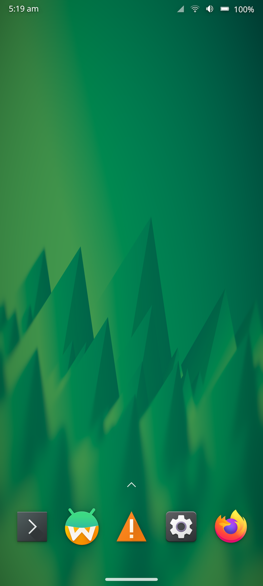
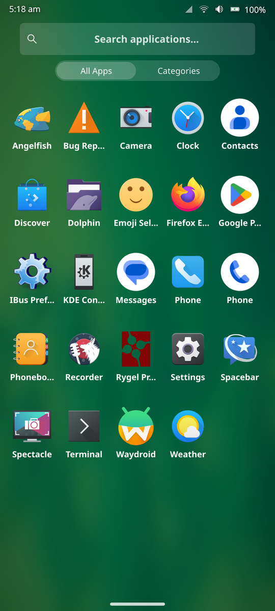
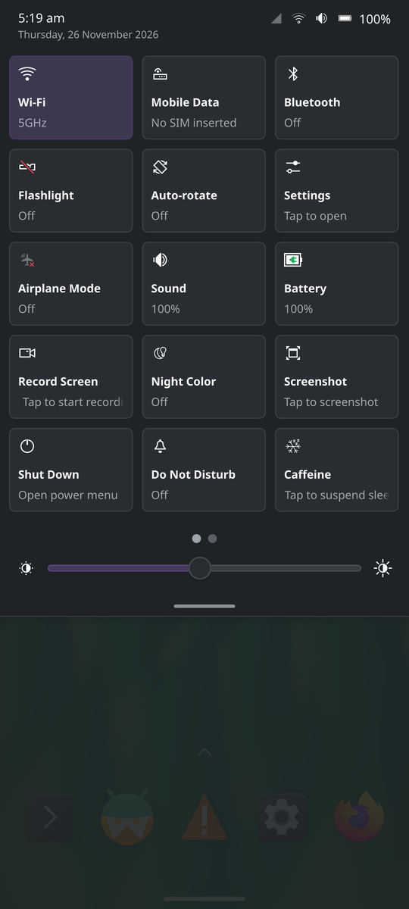
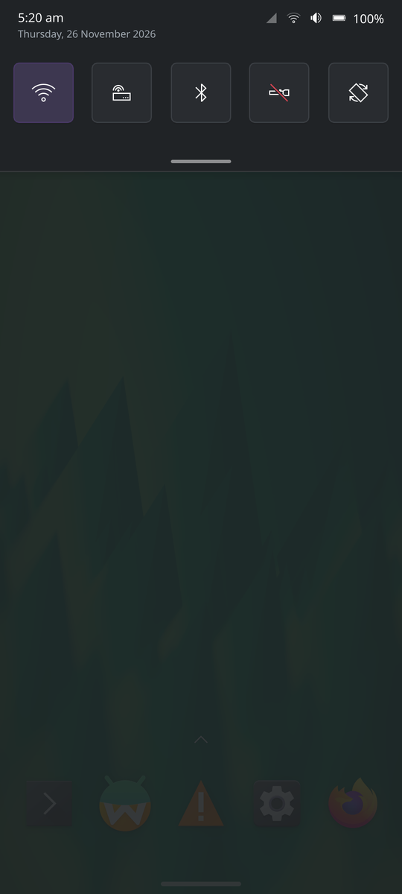
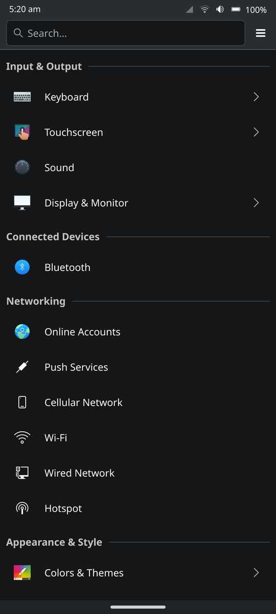
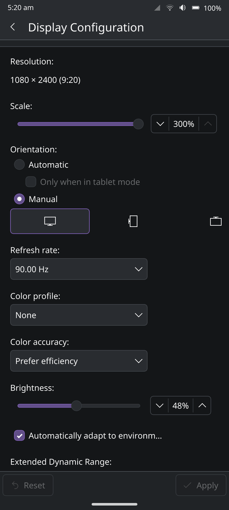
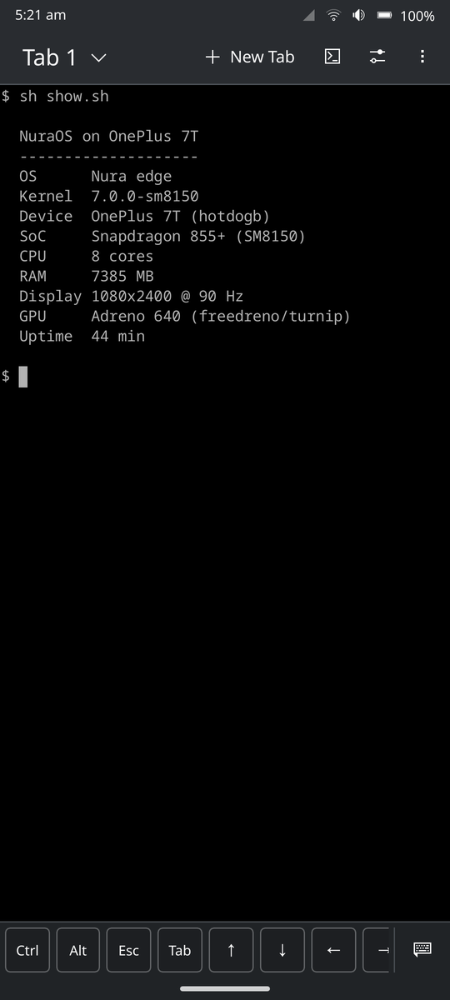
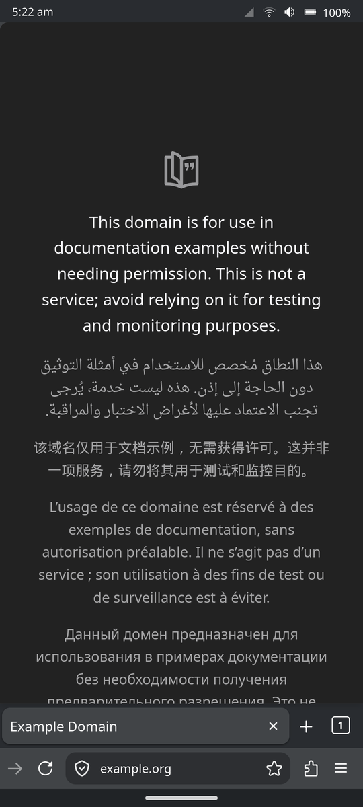

# OnePlus7T-NuraOS

OnePlus 7T on mainline Linux (postmarketOS) — progress update, 26 Nov 2026

Work in progress, **not a release**. No images, kernels or firmware are published here.

The goal: run the OnePlus 7T (SM8150, "hotdogb") as a real Linux phone on a mainline-based kernel, without Android.
Plasma Mobile (Qt 6.12) is the UI; Plasma Desktop is installed as an optional second session.

## What works (tested on the device)
- Display 1080x2400 at 60/90 Hz, touch, GPU (Adreno 640, open source drivers)
- Wi-Fi (5 GHz) and Bluetooth, USB gadget networking, charging and battery gauge
- Speakers, microphones, flashlight
- Sensors (accelerometer, gyroscope, magnetometer, proximity, light) and auto-rotate
- Vibration motor (feedbackd), for typing, notifications and the alert slider
- Alert slider (silent / vibrate / ring) mapped to feedbackd profiles and Plasma event sounds
- Brightness control and automatic brightness
- Modem boots and registers on LTE; the modem crash-recovery hang (IPA/GSI) is fixed

## This week
- Fixed empty quick-settings tiles (a negative page size reached the model at startup)
- Fixed the modem hanging for minutes after a crash (the crash handler waited forever on a dead GSI channel)
- Added vibration, slider and notification feedback
- Optional Plasma Desktop session next to Plasma Mobile (`nura-session`)
- Our patches are kept safe from package updates with a small signed package repository

## Not working yet
- Calls, SMS and mobile data (needs more SIM testing; VoLTE/IMS is missing)
- Camera, fingerprint reader, NFC (the chip is detected but silent), hardware video decode
- Fast charging
- Suspend with Wi-Fi on: the modem still crashes in about half of the sleep cycles (it now recovers)
- Settings > Display page layout glitch after rotating back to portrait

## Screenshots

Plasma Mobile on the OnePlus 7T, running on the mainline-based kernel.

<table>
<tr>
<td align="center"> Home screen</td>
<td align="center"> App drawer</td>
<td align="center"> Quick settings</td>
<td align="center"> Compact quick settings row</td>
</tr>
<tr>
<td align="center"> Settings</td>
<td align="center"> Display: 1080x2400 at 90 Hz</td>
<td align="center"> Terminal</td>
<td align="center"> Firefox ESR</td>
</tr>
</table>

Contributions and ideas are welcome once the first public release is ready.
